  

  

## About me

I'm a full-stack developer with Five years of hands-on experience turning business requirements into production software: storefronts with online payments, clinic platforms, ERP extensions and offline desktop systems.

- Building enterprise solutions at **Bellatrix**
- **NetSuite Certified Administrator** (2025), connecting custom development with ERP
- **Freelancer** delivering projects end-to-end, from requirements to deployment
- Main stack: **Node.js / NestJS** on the backend, **Next.js / React** on the frontend
- Experienced with **Arabic-first, RTL and bilingual** products

  

## Tech stack

  

  

## Featured projects

| Project | What it does | Built with |
|---|---|---|
| **[Bellatrix — Corporate Site & CMS](https://github.com/mos1239487394823939839223/Bellatrix-next.js)** | Company website with a built-in admin CMS: drag-and-drop page builder, templates, messages and SEO | `Next.js 16` `React 19` `Redux` `Tailwind` |
| **[Sama Pharmacy — Desktop POS](https://github.com/mos1239487394823939839223/samaPharmacy)** | Offline, Arabic-first pharmacy system: keyboard-only POS, batch & expiry tracking, purchases, shifts, insurance and narcotics register | `Electron` `TypeScript` `SQLite` |
| **[Oman E-Commerce — API](https://github.com/mos1239487394823939839223/Oman-Site-Backend)** | Production REST API: auth & roles, catalog, cart, coupons, orders, invoices and Thawani / Stripe payments | `Node.js` `Express` `MongoDB` `Docker` |
| **[Oman E-Commerce — Storefront](https://github.com/mos1239487394823939839223/Oman-Site-Frontend)** | Bilingual Arabic/English store with full RTL, cart, wishlist, checkout and admin area | `Next.js 15` `MUI` `i18next` |
| **[Nafs — Telemedicine Platform](https://github.com/mos1239487394823939839223/Nafs-Site)** | Portals for patients, doctors, support and admins: bookings, session notes, live chat and push notifications | `React` `Vite` `SignalR` `Firebase` |
| **[CandiMeter — Graduation Project](https://github.com/mos1239487394823939839223/Graduation-Project)** | Platform connecting students with universities, faculties, activities and internships | `Angular` `Material` `RxJS` |

<b>More work (private client projects)</b>

 

| Project | What it is |
|---|---|
| **Workforce Self Service** | HR self-service, approvals and attendance dashboards inside NetSuite |
| **Real-estate module for NetSuite** | Property, leasing and sales flows built on the ERP |
| **Teaching Platform** | Udemy-style learning platform for an academy |
| **Hotel Management System** | Reservations, rooms and billing |
| **Driver mobile app** | Companion app for delivery drivers |

Source code is private under client agreements. Happy to walk through any of them.

## GitHub stats

  
  

  

## Right now

- Shipping NetSuite extensions (HR self-service and real-estate) at Bellatrix
- Building an offline desktop POS with Electron and SQLite
- Levelling up on system design, testing and cloud deployment

## Let's work together

Need a web app, an API, a NetSuite customization or a full product built end-to-end? Get in touch.

**[LinkedIn](www.linkedin.com/in/mostafa-anwer-)** · **[Email](mostafaelfallah4@gmail.com)** · **[WhatsApp](https://wa.me/01554016562)**

<!-- profile README -->
